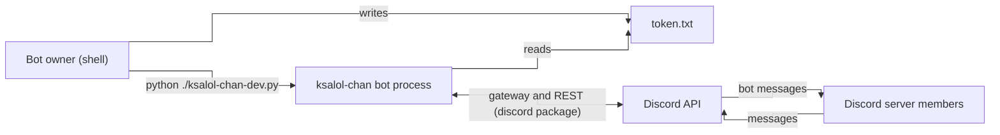
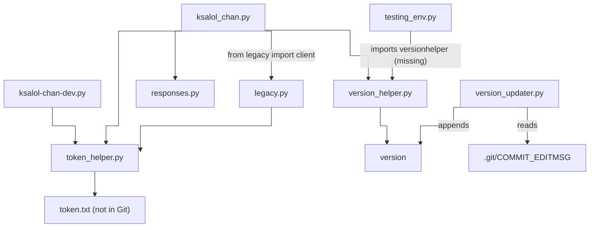
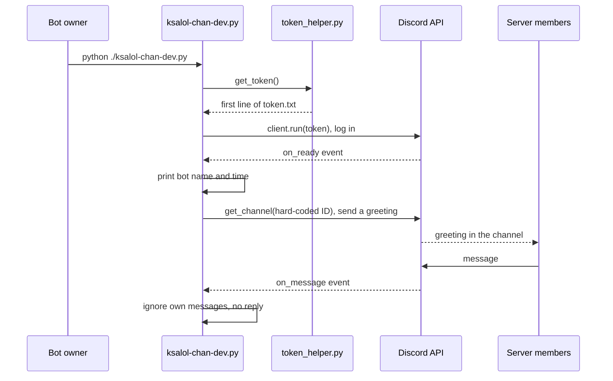

# ksalol-chan: architecture

This document describes the architecture of `ksalol-chan` in the arc42 layout. It covers the code on the default
branch (`master`). Every statement names the file that shows it.

## 1. Introduction and goals

`ksalol-chan` is a Discord bot in Python, marked as alpha in [README.md](../../README.md). The README starts the
bot with `ksalol-chan-dev.py`.

| Goal | Where it shows |
| --- | --- |
| Log in to Discord with a token kept outside the source | [`token_helper.py`](../../token_helper.py), [`.gitignore`](../../.gitignore) |
| Announce that the bot is online in 1 configured channel | `on_ready()` in [`ksalol-chan-dev.py`](../../ksalol-chan-dev.py) |
| Answer fixed text commands, in the channel or as a private message | [`responses.py`](../../responses.py), `send_msg()` in [`ksalol_chan.py`](../../ksalol_chan.py) |
| Show the bot version from a plain file | [`version_helper.py`](../../version_helper.py), [`version`](../../version) |

Stakeholders: members of the Discord server where the bot runs; the bot owner, who holds the token.

## 2. Constraints

| Constraint | Evidence |
| --- | --- |
| Python with the `discord` package from PyPI, not pinned to a version | [`requirements.txt`](../../requirements.txt) |
| Windows PowerShell and Linux setups are both documented | [README.md](../../README.md) |
| The bot token lives in `token.txt` in the working directory; Git ignores the file | [`token_helper.py`](../../token_helper.py), [`.gitignore`](../../.gitignore) |
| Helper files are opened by relative path (`./token.txt`, `version`), so the bot must start in the repository folder | [`token_helper.py`](../../token_helper.py), [`version_helper.py`](../../version_helper.py) |
| No license file in the repository | `git ls-files` |

## 3. Context and scope

In scope: 1 bot process, 1 Discord token, text messages. Out of scope: hosting, a database, slash commands, tests
(the folder [`test/`](../../test/discordchan-changelog.txt) holds only a changelog text file).

## 4. Solution strategy

| Problem | Approach | Evidence |
| --- | --- | --- |
| Connect to Discord | Subclass `discord.Client` and override the event methods `on_ready` and `on_message` | [`ksalol-chan-dev.py`](../../ksalol-chan-dev.py), [`legacy.py`](../../legacy.py) |
| Keep the token out of Git | Read the first line of an ignored `token.txt` | [ADR 0001](adr/0001-token-in-ignored-file.md) |
| Separate reply text from transport | `responses.get_response()` maps a message to a reply; `send_msg()` sends it | [ADR 0003](adr/0003-reply-table-separate-from-transport.md) |
| Track the version | First line of the `version` file; a script appends commit messages | [ADR 0002](adr/0002-version-in-plain-file.md) |

## 5. Building block view

| Block | Responsibility |
| --- | --- |
| [`ksalol-chan-dev.py`](../../ksalol-chan-dev.py) | Current entry point (README). `MyClient(discord.Client)`: `on_ready` prints the bot name and time and sends a message to 1 channel with a hard-coded ID; `on_message` ignores the bot's own messages and does nothing else. |
| [`ksalol_chan.py`](../../ksalol_chan.py) | Second bot variant: `commands.Bot` with the prefix `!` or a mention, `send_msg()` for channel or private replies (a message that starts with `?` gets a private reply), `run_ksalol_sama()` as its start function. No file in the repository calls `run_ksalol_sama()`. |
| [`legacy.py`](../../legacy.py) | First bot version (`MyClient(discord.Client)`) with text triggers. It creates its client and calls `client.run(TOKEN)` at module level. |
| [`responses.py`](../../responses.py) | `get_response(msg)`: fixed replies for `ksalol`, `!help` and `!h`; the string `'None'` for every other message. |
| [`token_helper.py`](../../token_helper.py) | `get_token()`: first line of `./token.txt`, stripped. |
| [`version_helper.py`](../../version_helper.py) | `get_version()`: first line of `version`, stripped. |
| [`version_updater.py`](../../version_updater.py) | Appends the lines of `.git/COMMIT_EDITMSG` with a timestamp to `version`. Runs when the file is executed. |
| [`testing_env.py`](../../testing_env.py) | Prints the version through the old module name `versionhelper`. |
| [`ksalol-sama.png`](../../ksalol-sama.png), [`ksalol-sama/`](../../ksalol-sama/ksalol-sama-background.png) | Avatar images; the README shows `ksalol-sama.png`. |

## 6. Runtime view

Main flow: start of `ksalol-chan-dev.py` (the command in [README.md](../../README.md)).

The client is created with `discord.Intents.default()`, without the message-content intent
([`ksalol-chan-dev.py`](../../ksalol-chan-dev.py)).

## 7. Deployment view

The bot runs as 1 foreground Python process on the owner's machine, started from the repository folder in a
virtual environment `.venv` (Linux) or with `python.exe` (Windows PowerShell) ([README.md](../../README.md)).
There is no service file, container or CI configuration in the repository (`git ls-files`).

## 8. Crosscutting concepts

- **Secrets.** The token is read from `token.txt`; `.gitignore` lists `token.txt`, `.venv/`, `.vscode/` and
  `__pycache__/`.
- **Error handling.** `send_msg()` catches every exception and prints it; `version_updater.py` prints a message
  when `.git/COMMIT_EDITMSG` is missing.
- **Logging.** `print()` to standard output: start time, version, and in `ksalol_chan.py` every received message
  with author and channel.
- **Language.** Reply texts and notes in [`todo.md`](../../todo.md) are in Polish; code identifiers are in English.

## 9. Architecture decisions

- [ADR 0001: Keep the bot token in an ignored `token.txt`](adr/0001-token-in-ignored-file.md)
- [ADR 0002: Keep the version in a plain `version` file](adr/0002-version-in-plain-file.md)
- [ADR 0003: Keep reply texts in `responses.py`, apart from the Discord transport](adr/0003-reply-table-separate-from-transport.md)

## 10. Quality requirements

Not applicable: the repository has no tests, no CI and no stated quality targets; [`todo.md`](../../todo.md) lists
open work instead.

## 11. Risks and technical debt

| Risk or debt | Evidence |
| --- | --- |
| Before commit `726faec`, `legacy.py` held the bot token in the source. The Git history keeps that version. | `git show 726faec -- legacy.py` |
| `ksalol_chan.py` runs `from legacy import client`; importing `legacy.py` calls `client.run(TOKEN)` at module level, so the legacy bot starts on import | [`ksalol_chan.py`](../../ksalol_chan.py), [`legacy.py`](../../legacy.py) |
| In `ksalol_chan.py`, `on_message` is registered on a `discord.Client` that never runs; `run_ksalol_sama()` runs `bot` instead | `run_ksalol_sama()` in [`ksalol_chan.py`](../../ksalol_chan.py) |
| In `ksalol_chan.py`, `on_message` does not return on the bot's own messages (`pass` instead of `return`), and `user_msg[0]` fails on an empty message | `run_ksalol_sama()` in [`ksalol_chan.py`](../../ksalol_chan.py) |
| `legacy.py` defines `on_ready` twice; the second definition replaces the first and holds the trigger code, which refers to `message` from `from discord import message` | [`legacy.py`](../../legacy.py) |
| `legacy.py` sends image files that the repository does not contain | [`legacy.py`](../../legacy.py), `git ls-files` |
| `testing_env.py` imports `versionhelper`, renamed to `version_helper` in commit `a89b94b` | [`testing_env.py`](../../testing_env.py) |
| `requirements.txt` lists `datetime` and `responses`; pip resolves these names on PyPI, not to the standard-library module and the local `responses.py` | [`requirements.txt`](../../requirements.txt) |
| `discord` is not pinned to a version | [`requirements.txt`](../../requirements.txt) |
| The channel ID and image URLs are hard-coded; the URLs point to the old repository name `discordchan` | [`ksalol-chan-dev.py`](../../ksalol-chan-dev.py), [`ksalol_chan.py`](../../ksalol_chan.py) |
| `version_updater.py` is not wired to a Git hook; [`todo.md`](../../todo.md) lists automatic updates as open work | [`version_updater.py`](../../version_updater.py), [`todo.md`](../../todo.md) |
| In `responses.py` the second `ksalol` branch is unreachable: an exact match already matches the lower-case branch | [`responses.py`](../../responses.py) |
| Some text triggers in `legacy.py` send offensive messages | [`legacy.py`](../../legacy.py) |

### Open questions

- Whether the token removed in commit `726faec` is still valid is not recorded. If it is, it must be revoked in the
  Discord developer portal.
- `ksalol_chan.py` creates `commands.Bot(...)` without an `intents` argument. Whether this starts depends on the
  installed `discord` version, which `requirements.txt` does not pin.
- Which of the 3 bot files is meant to become the main bot is not recorded; the README names `ksalol-chan-dev.py`.

## 12. Glossary

| Term | Meaning |
| --- | --- |
| Ksalol-sama | The bot's persona and avatar image |
| Token | The Discord bot token in `token.txt` |
| Intents | Discord gateway event categories a client asks for (`discord.Intents`) |
| `on_ready`, `on_message` | Event handlers that the `discord` package calls after login and for each message |
| Legacy bot | The first bot version in `legacy.py` |
| Private reply | A reply sent to the author as a direct message; in `ksalol_chan.py` triggered by a leading `?` |
